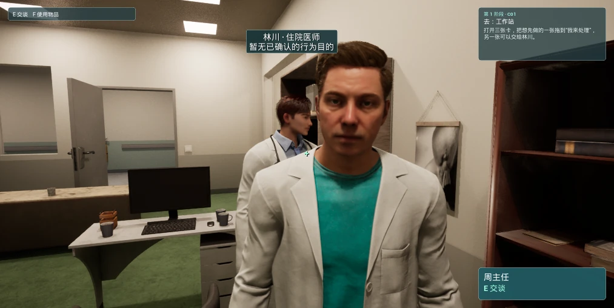
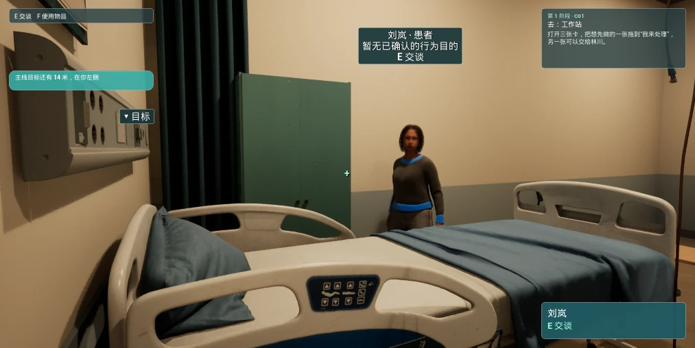

[English](README.md) | [简体中文](README.zh-CN.md)

# Readable/Unreadable — 被系统理解，也保留自己的解释

[项目网页](https://ruixiaozhang.com/#work-aidirector)

《Readable/Unreadable》是我的硕士毕业设计：一场发生在虚构医院里的互动叙事。系统试着理解玩家，玩家也能核对、修正或拒绝这份解读。它也是 World Chronicle（我开发中的叙事游戏系统）的第一款游戏。2026 年 11 月 9 日之前，本概览用 World Chronicle 指称这项毕设。

一班工作发生的病房，UE 实机静帧。呈现场景，不作为完整任务已经可玩的证据。

## 怎样玩

玩家先说明自己的游玩偏好，并回应一组与情境有关的问题；作品围绕一份暂时的系统解读展开，让玩家能够查看、补充、修正，也可以拒绝。

进入医院后，玩家在医生、护士、清洁工中选择一个身份，和 AI 扮演的上级与同事一起处理一班工作。双方在各种情境里各自作出判断，每一次选择都会写进“世界纪事”：已经发生的路径被点亮，没有选的路径也保留下来，供事后回看。

## 当前进展：2026 年 11 月

11 月，医生线已能在自动运行中连续推进到前半程。AI 同事按剧情走动、乘电梯上下楼、坐到床边，从柜子里取出文件再放回，也会为别人让路；台词在现场生成并配音。玩家的选择会改变后续剧情，局内也能打开回看卡片，接受、更正或涂黑系统记下的内容。这些运行都使用合成答卷和自动操作，不是真人游玩。

离线开发局的实机画面：周主任与林川在交班办公室。身份卡写着姓名、职务和“暂无已确认的行为目的”，右上角是本段任务。使用合成答卷，不是真人游玩。

离线开发局的实机画面：病人刘岚在自己的病房里，准星对准她时出现交谈提示。使用合成答卷，不是真人游玩。

医生线的后半程与结局、结尾的世界纪事与回看、护士和清洁工两条线，以及约二十分钟的试玩和回放访谈仍在制作和准备中；真人试玩尚未开始。完整题目、画像字段、剧情分支、导演规则与测试材料不公开。

## 中期汇报：2026 年 10 月

原型已经能从问答走到 Unreal Engine 中的医院装配和第一人称入场；AI 同事会走到床旁、坐下、阅读交接卡并开口回应，开场几个情节节点能在同一次运行中连续完成。

[观看中期演示视频（1:21，720p，无声）](docs/media/world-chronicle-demo-720p.mp4)

演示使用合成答卷和自动操作，不是真人游玩记录。开头展示了三道空间问题的示例作答；其中约十五秒的开发面板显示了内部问卷编号，已做模糊处理。

中期汇报时，接下来要完成的是：完整的一班体验、让选择真正走向不同后续的分支，以及约二十分钟的试玩和回放访谈。参与者研究尚未开始。

## 空间与选择

床位、床帘和床边的空间决定人站在哪里说话，也会潜移默化地影响玩家的判断。

一局医院的楼层平面。病房、工作站与走廊的连接决定任务路线和沿途能看到的信息；房间名为公开说明而重新标注。

## 我的工作

艺术构思、交互设计、研究框架与原型开发。论文以“通过设计开展研究”的方式，研究人和 AI 怎样相互理解，以及玩家怎样在行动与回看中解释自己的选择。

## 相关页面

[AINPC CHI](https://github.com/Shawn200212/AINPC-CHI) · [AIWG](https://github.com/Shawn200212/AI-World-Generator)

[公开范围](DISCLOSURE.md) · [素材清单](docs/public-media.json) · [权利与署名](RIGHTS_AND_CREDITS.md)

概览更新于 2026 年 11 月 9 日。正文、图片和演示视频与项目网页保持一致。本仓用于研究介绍，不是可运行工程或完整研究材料。
